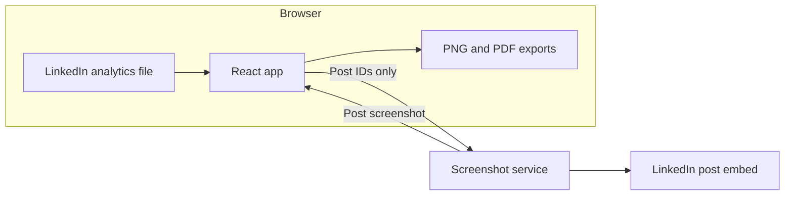

# Wrapped for LinkedIn

[](https://render.com/deploy?repo=https://github.com/render-examples/wrapped-for-linkedin)

Wrapped for LinkedIn turns your LinkedIn analytics export into a year-in-review story, inspired by Spotify Wrapped. It shows your top posts, who saw your posts, and the badges you earned this year.

All of your analytics data stays in your browser. The app runs on [Render](https://render.com/). See [Architecture](#architecture) for what the backend does.

Created by [Shifra Williams](https://www.linkedin.com/in/shifra-williams/) and [Venkata Naga Sai Kumar Bysani](https://www.linkedin.com/in/saibysani18/).

> [!NOTE]
> This project is not affiliated with, endorsed by, or connected to LinkedIn or Microsoft.

🫶 _Made with love for the developer community_

## Features

- **Shareable cards**: Download story cards as PNG or PDF and post them on LinkedIn. On phones, share them to the LinkedIn app from the share sheet.
- **Top posts**: See your posts ranked by engagements, with their impressions.
- **Badges**: Earn badges for 1M+ impressions, a 100K+ impression post, 1,000+ new followers, 20+ posts with 10+ engagements, or engagement in all 12 months.
- **Audience demographics**: See who saw your posts by job title, location, industry, seniority, company size, and company.
- **Story navigation**: Swipe through cards like Instagram stories. Cards autoplay, and you can press and hold to pause.
- **Demo data**: Try the app with sample data before you upload your own file.
- **Local caching**: The app caches your data in your browser, so it loads again when you reload the page. A new tab starts empty.

## Get your Wrapped for LinkedIn

1. Export your [LinkedIn analytics](https://www.linkedin.com/analytics/creator/content/?metricType=ENGAGEMENTS&timeRange=past_365_days) as an Excel file. The [Wrapped for LinkedIn landing page](https://wrappedforlinkedin.onrender.com/) has step-by-step instructions.
1. Open [wrappedforlinkedin.onrender.com](https://wrappedforlinkedin.onrender.com/) and upload the file.
1. Look through your stories and share the cards you like. On a phone, tap **Share to LinkedIn** and paste the copied post text into your post.

## Run locally

You need Node.js 22.18 or later. Node runs the TypeScript files in `screenshot-service/`, `site/og/`, and `site/fixtures/` directly, without a build step.

```bash
git clone https://github.com/render-examples/wrapped-for-linkedin.git
cd wrapped-for-linkedin
npm install --prefix site
bin/preview.sh
```

Open `http://localhost:5173`.

The site works without the screenshot service, but exported cards then show no post screenshots. To run the service locally, open a second terminal:

```bash
cd screenshot-service
npm install
ALLOWED_ORIGINS=http://localhost:5173 npm start
```

The service listens on port 10000, which matches `VITE_SCREENSHOT_SERVICE_URL` in `site/.env.development`.

### Tests

```bash
npm test --prefix site
npm test --prefix screenshot-service
```

## Architecture



All of your analytics data stays in your browser. The React app parses the file, builds the cards, and renders the PNG and PDF exports on your device. The file and its contents are never sent to a server.

The screenshot service is the only backend. The app sends it only the IDs of your top posts, such as `urn:li:share:123`. The service does two things:

- It checks whether each top post is public, so the app shows an embed only for posts that other people can see.
- It takes a screenshot of the Peak Performer post for card exports. The browser can't capture a LinkedIn embed, because the embed comes from another site.

The service logs only status codes. It does not log post IDs, IP addresses, or headers.

## Project structure

| Path | Contents |
| --- | --- |
| `site/` | React, TypeScript, and Vite app. See `site/src/README.md` for its architecture. |
| `screenshot-service/` | Express service that uses Playwright to take screenshots of public LinkedIn post embeds. |
| `render.yaml` | Render Blueprint for the static site and the screenshot service. |
| `bin/preview.sh` | Starts the site's development server. |

## Deploy to Render

Click **Deploy to Render** at the top of this README. The Blueprint creates two services:

- `wrappedforlinkedin` is a static site.
- `wrapped-for-linkedin-screenshots` is a Docker web service. It uses the Standard plan because Chromium needs about 1 GB of memory. It autoscales from 1 to 4 instances, which needs a Professional workspace or higher. In a Hobby workspace, remove the `scaling` block from `render.yaml` before you deploy.

If you deploy under different service names, update `VITE_SCREENSHOT_SERVICE_URL` and `ALLOWED_ORIGINS` in `render.yaml` to match the new URLs.

## Contribute

1. Fork the repository.
1. Create a feature branch.
1. Commit your changes.
1. Push the branch and open a pull request.

## License

This project uses the MIT License. See [LICENSE](LICENSE).
